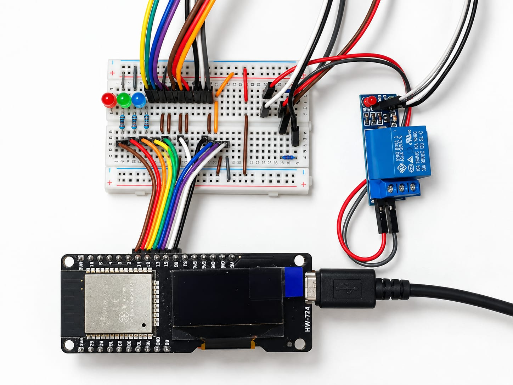

<div align="center">

# 🌱 PlantControl — Sistema Inteligente de Irrigação Automatizada

**Automação residencial acessível com controle determinístico na borda (*Edge Computing*), intertravamentos físicos de segurança e suporte agronômico via Inteligência Artificial.**


[Visão Geral](#-visão-geral) • [Arquitetura](#-arquitetura-do-sistema) • [Funcionalidades](#-funcionalidades-e-segurança) • [Galeria](#-galeria-do-protótipo-e-telas) • [Execução](#-como-executar) • [Limitações](#-escopo-e-limitações)

</div>

---

## 📌 Visão Geral

O **PlantControl** é um sistema embarcado integrado a um aplicativo móvel desenvolvido para automatizar o manejo hídrico de cultivos domésticos e pequenas hortas urbanas. Diferente de temporizadores convencionais que irrigam em horários fixos sem considerar a real condição do solo, o sistema monitora a umidade do substrato em tempo real e atua de forma autônoma, segura e parametrizável.

O projeto foi estruturado em **três camadas complementares**, garantindo que a integridade do cultivo e do hardware não dependa de conexão contínua com a internet.

---

## 🏗️ Arquitetura do Sistema

```text
[Sensores Solo/Nível] ──► [ESP32 (Edge: Histerese + Travas)] ──► [Relé + Bomba D'água]
                                      │ ▲
                           Wi-Fi / Bluetooth (Híbrido)
                                      ▼ │
                     [App Android (Algoritmos + Catálogo)]
                                      │
                               Sob Demanda (HTTPS)
                                      ▼
                         [Google Gemini API (Diagnóstico)]
```

| Camada | Componente | Responsabilidade Principal |
| :--- | :--- | :--- |
| **1. Borda (*Edge*)** | **ESP32** | Leitura contínua de sensores, calibração em dois pontos, banda de histerese (`40%–60%`) e intertravamentos críticos via temporização assíncrona (`millis()`). |
| **2. Aplicativo Local** | **App Android** | Sincronização de **14 espécies botânicas**, cálculo estimado de secagem ($t_{secar}$) e ajuste de parâmetros ambientais/luminosidade via software. |
| **3. Nuvem / IA** | **Gemini API** | Geração sob demanda de diagnósticos de manejo, análise hídrica e padrões microclimáticos com base na telemetria e no perfil da planta. |

---

## ⚙️ Funcionalidades e Segurança

### 🔌 Controle Embarcado e Proteções Físicas
* **Controle por Histerese (40% – 60%):** Liga a bomba automaticamente quando a umidade cai abaixo de `40%` e desliga ao atingir `60%`, evitando o efeito *chattering* (acionamentos e desligamentos rápidos e repetitivos do relé).
* **Bloqueio por Reservatório Vazio:** Sensor de nível (boia) com prioridade máxima que impede o funcionamento da bomba a seco.
* **Parada de Emergência Física:** Botão físico dedicado para corte imediato da atuação, com tempo médio de resposta aferido em **0,38 segundos** nos testes de bancada.
* **Supervisão Local Independente:** Display OLED I2C exibindo valor bruto ADC, percentual de umidade e mensagens de status junto aos LEDs indicadores (Azul, Verde e Vermelho).

### 📱 Aplicativo Móvel e Acessibilidade
* **Comunicação Híbrida:** Funciona via rede Wi-Fi local (HTTP) ou Bluetooth, mantendo a interação mesmo sem roteador disponível.
* **Catálogo com 14 Espécies:** Perfis botânicos pré-configurados com faixas ideais de umidade, temperatura e incidência luminosa.
* **Conformidade com WCAG 2.1:** Alto contraste (`> 7:1`), escalonamento de texto até `130%` e suporte a leitores de tela (*TalkBack*).

---

## 🖼️ Galeria do Protótipo e Telas

> **Figura 1 — Protótipo físico em bancada e interfaces do sistema PlantControl**

| Montagem em Bancada | Tela Principal / Telemetria | Consultoria por IA |
| :---: | :---: | :---: |
|  |  |  |
| *ESP32, OLED I2C, Relé e Sensores* | *Leitura e controle em tempo real* | *Diagnóstico via Gemini API* |

*Fonte: PlantProject (2026).*

---

## 🛠️ Tecnologias Utilizadas

### Hardware
* **Microcontrolador:** ESP32 DevKit V1 (Wi-Fi / Bluetooth integrado)
* **Sensores:** Sensor de umidade capacitivo do solo + Sensor de nível de água (boia)
* **Atuação:** Módulo relé 5V (1 canal) + Mini bomba d'água submersível
* **Interface Física:** Display OLED 0.96" (I2C) + LEDs de estado + Botão de emergência

### Software
* **Firmware:** C / C++ na Arduino IDE (`millis()` para execução não bloqueante)
* **Aplicativo:** Android (`[Kotlin / Java / Flutter / React Native]`)
* **Inteligência Artificial:** Google Gemini API
* **Versionamento:** Git e GitHub

---

## 📁 Estrutura do Repositório

```text
PlantControl/
├── PlantControl_ESP32.C                  # Código-fonte do ESP32 (.c)
├── PlantControlAPP/                # Código-fonte do aplicativo Android
├── index.html                     # Modelo Conceitual do aplicativo
└── imagens/                   # Fotos da bancada e capturas de tela
```

---

## 🚀 Como Executar

### Pré-requisitos
* **Arduino IDE** com o pacote de placas **ESP32** (`esp32 by Espressif Systems`) instalado;
* Bibliotecas: `Adafruit SSD1306`, `Adafruit GFX` e `ArduinoJson`;
* Dispositivo Android (or emulador) e chave da **Google Gemini API**.

### 1. Firmware (ESP32)
```bash
git clone https://github.com/[seu-usuario]/PlantControl.git
cd PlantControl/firmware/PlantControl_ESP32
```

Crie o arquivo `secrets.h` (não versione esse arquivo):
```cpp
#define WIFI_SSID "SUA_REDE_WIFI"
#define WIFI_PASSWORD "SUA_SENHA_WIFI"
```

1. Conecte o ESP32 via cabo USB;
2. Selecione a placa e a porta COM na Arduino IDE;
3. Faça o upload do código e abra o Monitor Serial em `115200 baud` para conferir o IP e os logs.

### 2. Aplicativo Móvel
1. Abra a pasta `mobile-app/` no ambiente de desenvolvimento (`[Android Studio / VS Code — preencher]`);
2. Configure a chave da API no arquivo local (`local.properties` ou `.env`):
   ```properties
   GEMINI_API_KEY=sua_chave_aqui
   ```
3. Compile, instale no dispositivo Android e conecte à rede Wi-Fi do ESP32 (ou via Bluetooth).

> ⚠️ **Atenção:** Mantenha arquivos com senhas e chaves (`secrets.h`, `.env`, `local.properties`) fora do versionamento público.

---

## ⚠️ Escopo e Limitações Atuais

* **Ambiente de Teste:** Os ensaios foram realizados em bancada laboratorial com substrato padrão e reservatório de testes.
* **Luminosidade e Clima:** A incidência luminosa e as condições ambientais são tratadas como **parâmetros lógicos e perfis configurados via software/IA**, sem sensor fotoelétrico físico acoplado ao protótipo atual.
* **Estágio de Prototipação:** A montagem atual utiliza protoboard, exigindo PCB dedicada e invólucro com proteção contra umidade (IP65) para uso contínuo em áreas externas.

---

## 👩‍🎓 Autoria e Orientação

* **Autoria:** `Victor Rodrigo da Silva Nascimento` e ` Maria Heloiza Costa de Souza`
* **Orientação:** Prof.ª MBA Luana Leal
* **Instituição:** Centro Universitário Fametro — Manaus/AM (2026)
